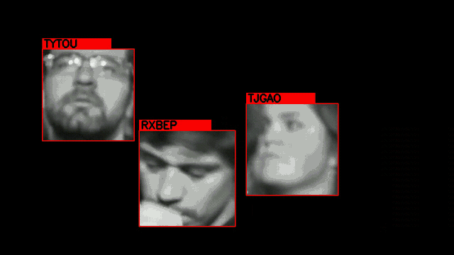
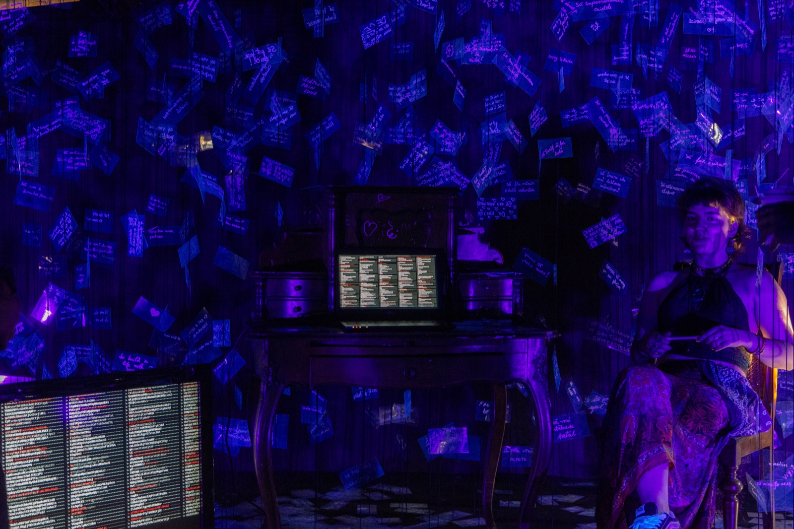
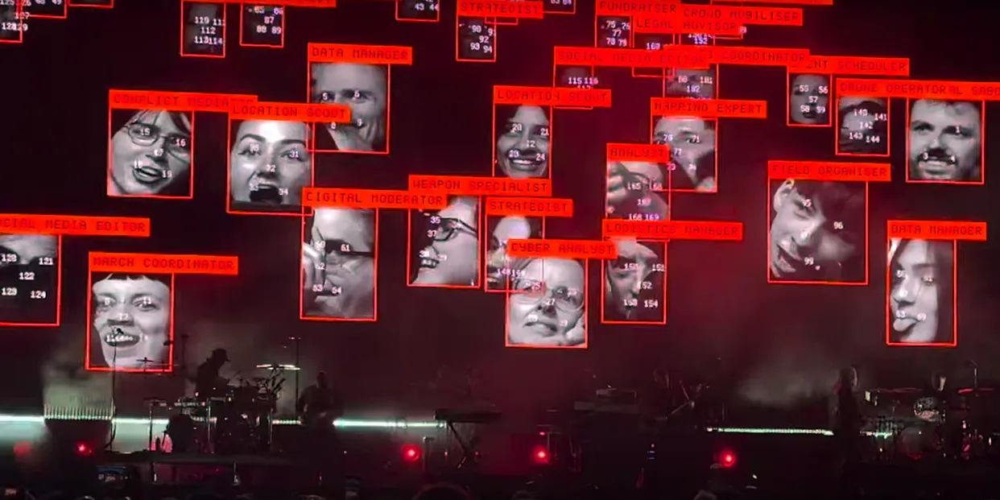

# massive-attack-face-recog

Massive Attack live show inspo because it looks amazingly cool.



# Gallery




# Project structure

```
face-recognition/   face detection animation (MediaPipe + OpenCV)
terminal-wall/      scrolling "data wall" animation in the terminal
fullscreen-text/    a single word stretched to fill the whole screen
content/            images and gifs used by this README
```

## Face recognition

Detects faces from the webcam or a video file and draws red boxes with random labels on a black background.

```sh
python face-recognition/main.py                                   # webcam
python face-recognition/main.py --input face-recognition/input.mp4 --output output.mp4
```

Press `Esc` to stop.

## Terminal wall

Fills the terminal with columns of random text, switching between a full and a sparse wall.

```sh
python terminal-wall/terminal.py
python terminal-wall/terminal.py -c 4 --interval 0.1 --phase-duration 3 --sparse-ratio 0.3
```

Press `Ctrl+C` to stop.

## Fullscreen text

Edit `TEXT`, `BOLDNESS` and `PADDING` at the top of the file, then run:

```sh
python fullscreen-text/fullscreen_text.py
```

Press any key to close.

# Inspiration


